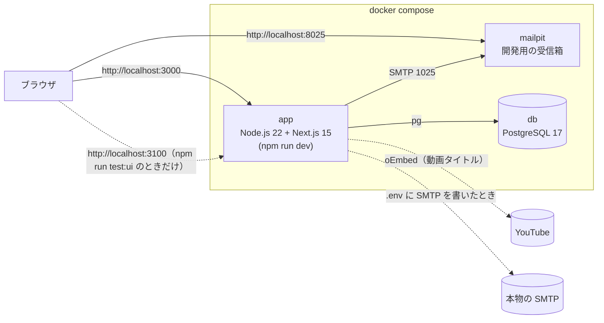
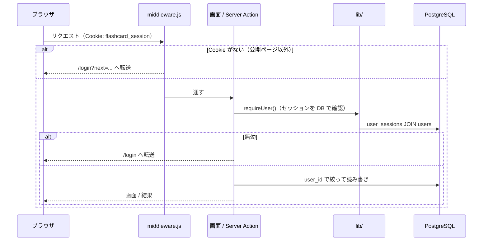

# 全体の構成

## 概要

個人用の英語学習アプリ。YouTube の字幕を貼り付けると、「知らない語が1〜3個だけの文」を探して例文カードにし、
間隔をあけて繰り返す記憶テストで覚える。和訳や解説は、API を使わずにチャット AI（claude.ai など）へ
プロンプトをコピーし、答えを貼り付けて取り込む（無料で使うため）。

## 動かし方（Docker）



| サービス | 役割 | 備考 |
| --- | --- | --- |
| `app` | 画面とサーバー処理（Next.js） | ソースは bind mount。`node_modules` と `.next` はコンテナ内のもの。テスト実行ツール（3100、このパソコンからだけ）もここで動かす |
| `db` | PostgreSQL 17 | データは volume `db_data` |
| `mailpit` | 送ったメールを受け取る開発用の受信箱 | 外には送らない |
| `e2e` | 画面のテスト（Playwright + Chromium）とテスト結果レポート | ふだんは起動しない（profile `e2e`）。`docker compose run --rm e2e` のときだけ。中でテスト用の DB（`flashcard_e2e`）につないだアプリを 3200 で動かす（外には出さない）。`node_modules` は volume `e2e_node_modules` |

- Mac に Node.js は入れない。`npm` はすべてコンテナの中で動かす（`docker compose exec app ...`）
- 起動時（`npm run dev`）に `scripts/migrate.mjs` が、まだ当てていない `db/migrations/*.sql` を番号順に当てる
- 環境変数は `compose.yaml`。メールの送り先などは `.env`（git に入れない。例は `.env.example`）

| 環境変数 | 用途 | 既定値 |
| --- | --- | --- |
| `DATABASE_URL` | DB の接続先 | `postgres://flashcard:flashcard@db:5432/flashcard` |
| `APP_URL` | メールのリンク・リダイレクト先の URL。`https:` なら Cookie に Secure を付ける | `http://localhost:3000` |
| `SMTP_HOST` / `SMTP_PORT` / `SMTP_SECURE` / `SMTP_USER` / `SMTP_PASS` | メールの送信先 | Mailpit |
| `MAIL_FROM` | 差出人 | `フラッシュカード <no-reply@flashcard.local>` |

## インターネットに公開するとき（Vercel ＋ Neon）

Docker の代わりに、アプリは Vercel、DB は Neon（どちらも無料の枠）で動かせる。手順は [deploy.md](deploy.md)。

- Vercel のビルドは `package.json` の `vercel-build`（先に `scripts/migrate.mjs` で DB のマイグレーションを当ててから `next build`）
- 実行中に `fs` で読む `data/` の語のリストは、`next.config.mjs` の `outputFileTracingIncludes` で公開するファイルに含める
- 単語帳の画面は `maxDuration = 120`（秒）。絵の自動生成で、画像生成サービスを最大90秒待つため

## ディレクトリ

```
app/                 画面（Next.js App Router）
  layout.js          共通のヘッダー（ログイン中は表示名とログアウト）
  page.js            トップ: 単語帳の一覧（タグで絞り込み、理解度）
  actions.js         単語帳の作成・削除、カードの追加
  auth/              ログイン・登録などの Server Action とフォーム
  login/ signup/ verify/ resend/ forgot-password/ reset-password/ account/
  decks/[id]/        単語帳画面（カード一覧、解説の取り込み、動画プレーヤー、物語の通し読み・スライド）
    import/          字幕の解析と、候補の文からカードを登録
    study/           記憶テスト
    edit/            単語帳の編集・削除
  cards/[id]/edit/   カードの編集・削除
  stories/new/       覚えた語で物語を作る
  settings/          レベル設定、「知ってる」の語、読み上げの設定
  stats/             統計（勉強時間と、手で時間を足すフォームも）
  api/study-time/    画面から勉強時間を受け取る（POST。sendBeacon で送ってくる）
  api/scenes/[id]/image/  物語の場面の絵を見る（GET）・取り込む（POST）。自分の場面だけ
  components/        共通の部品（読み上げ、強調表示、タグ、動画プレーヤー、勉強時間の計測など）
lib/                 サーバー側のロジック（画面から独立。単体テストの主な対象）
db/migrations/       テーブルの変更履歴（番号順）
data/                単語の頻出度リスト・イディオムのリスト
scripts/migrate.mjs  マイグレーションの実行
middleware.js        ログインしていない人をログイン画面へ送る
test/                単体テスト（Vitest）
e2e/                 画面のテスト（Playwright）
tools/test-runner/   ブラウザで単体テストを1件ずつ実行するツール（npm run test:ui）
tools/report/        テスト結果レポートを作る（docker compose run --rm e2e → reports/）
docs/                設計書
```

## 処理の流れ

画面は Server Component で DB を直接読み、変更は Server Action（`"use server"` の関数）で行う。API のエンドポイントは
`/verify`（確認メールのリンク）だけ。



- `middleware.js` は Cookie があるかだけを見る（Edge で DB を使わないため）。本当に有効かは各画面・各 Action の `requireUser()` が確かめる
- 画面は `export const dynamic = "force-dynamic"` で毎回 DB から読む。Action のあとは `revalidatePath` で表示を更新する
  （学習中の画面は読み直さないよう、`study/actions.js` だけは呼ばない）

## lib/ の役割

| ファイル | 役割 | DB |
| --- | --- | --- |
| `db.js` | 接続プール（ホットリロードで増えないよう globalThis に1つ） | ○ |
| `auth.js` | セッション、`getCurrentUser` / `requireUser`、持ち主の確認 | ○ |
| `uiPrefs.js` | 画面の小さな好み（説明を閉じたか）を覚える Cookie の名前。画面の部品からも使う | |
| `onboarding.js` | トップの「はじめの4ステップ」（終わったかの判定・閉じる） | ○ |
| `userAdmin.js` | メールなしでアカウントを作る・パスワードを作り直す・データを消して最初の状態に戻す（`scripts/create-user.mjs` / `reset-user.mjs` から使う） | |
| `passwordHash.js` / `emailAddress.js` | パスワードの決まりとハッシュ / メールアドレスの整え方。Next.js の外の道具からも使うので `password.js` / `accounts.js` から分けてある | |
| `allowlist.js` | 使える人をメールアドレスで決める（環境変数 `ALLOWED_EMAILS`。空ならだれでも） | |
| `accounts.js` | メールのリンク（確認・再設定）、登録の完了、メールの文面 | ○ |
| `password.js` | パスワードのハッシュ（scrypt） | |
| `mail.js` | メール送信（nodemailer）、`appUrl` | |
| `transcript.js` | 字幕を区間・文に分け、知らない語を数えて段階に分ける | |
| `vocab.js` | 単語の原形と頻出順位（`data/en-words.txt`、wink-lemmatizer） | |
| `idioms.js` | イディオムの照合（`data/idioms.tsv`） | |
| `sentences.js` | 字幕を文に整えるプロンプト、AI の答えの読み取り、カードの上書き | ○ |
| `cardPrompts.js` | カードの解説のプロンプトと、答えの読み取り | |
| `comprehension.js` | ユーザーの設定・語の状態で字幕を解析（理解度） | ○ |
| `settings.js` | レベル設定、知っている語・学習中の語 | ○ |
| `review.js` | 記憶テストの間隔、覚え具合の区分 | |
| `targets.js` | カードの覚えたい語（複数）の読み書き | ○ |
| `tags.js` | タグの整形と保存 | ○ |
| `scenes.js` | 物語の場面（作る・指示文）と絵（保存・自動で作る・見る・消す） | ○ |
| `imageGen.js` | 無料の画像生成サービス（Pollinations、キー不要）で絵を作る | |
| `sceneUtils.js` | 場面の分け方、絵の指示文、自動で作る URL、画像の種類の見分け。画面の部品からも使う | |
| `studyTime.js` | 勉強時間の記録・手で足す・消す・集計 | ○ |
| `studyClock.js` | 勉強時間の時計（操作・再生のあった間だけ数える）、時間の書き方。画面の部品から使う | |
| `swipe.js` | 左右のスワイプとタップを ← / → キーに置きかえる計算（iPhone・iPad 用）。画面の部品から使う | |
| `tagCandidates.js` | 単語帳の一覧で、さらに絞り込めるタグの候補（件数の多い順、同じ件数なら文字コード順）。画面の部品から使う | |
| `story.js` / `storyPrompt.js` | 物語のプロンプト、答えから単語帳を作る | ○ |
| `youtube.js` / `videoTitle.js` / `format.js` / `levels.js` | 小さな道具 | |

`import "server-only"` が付いたファイルは、ブラウザ側に入らない（Next.js がビルド時に止める）。
`youtube.js` / `format.js` / `levels.js` / `review.js` / `tagCandidates.js` / `studyClock.js` / `swipe.js` / `sceneUtils.js` / `uiPrefs.js` は画面の部品からも使う。

## 外部とのつながり

| 相手 | 使い方 | 失敗したとき |
| --- | --- | --- |
| YouTube oEmbed | 単語帳の名前が空のとき、動画タイトルを取る（API キー不要、5秒で打ち切り） | タイトルなし（手で入力） |
| YouTube の埋め込み（youtube-nocookie.com） | 単語帳の画面などで、カードの場面から動画を再生する | — |
| SMTP | 登録・再設定のメール | 「メールを送れませんでした」と表示 |
| チャット AI | アプリからは呼ばない。ユーザーがプロンプトをコピーし、答えを貼り付ける | — |
| Web Speech API | ブラウザの読み上げ（声と速さは localStorage に保存） | ボタンを出さない |
