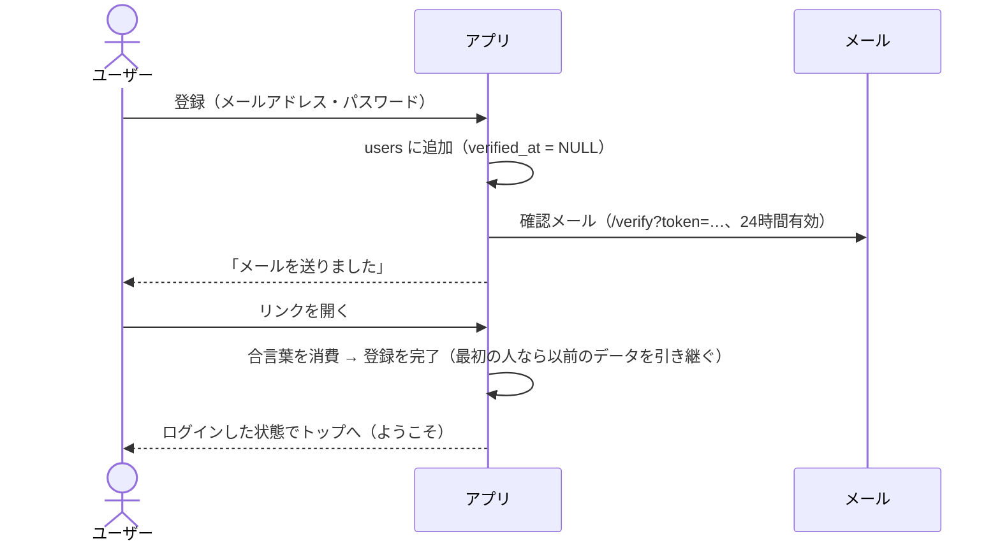
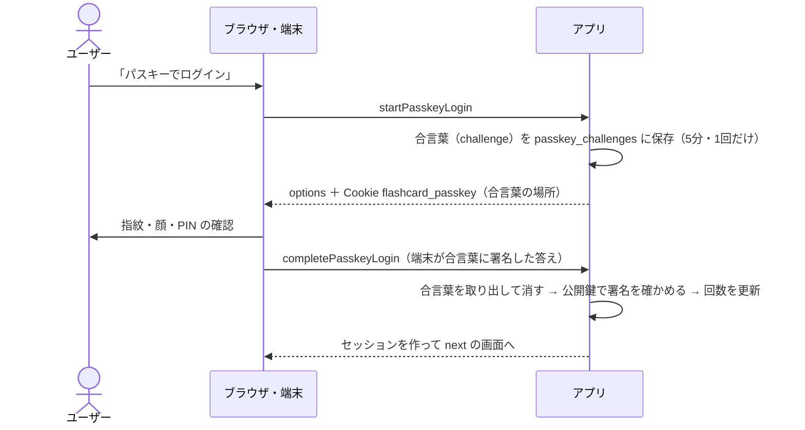

# ユーザー登録・ログイン

`lib/auth.js`、`lib/accounts.js`、`lib/password.js`、`app/auth/actions.js`、`app/verify/route.js`、`middleware.js`。

## 流れ

| 操作 | 処理 |
| --- | --- |
| 登録 `signup` | アドレスは前後の空白を除いて小文字に。パスワードは8〜200文字。登録済みなら「登録済みです」のメールだけ送る。未確認なら新しいパスワードにして確認メールを送り直す |
| 登録の完了 `/verify` | 合言葉が正しければ完了にしてログイン。だめなら再送の画面へ |
| 確認メールの再送 `resendVerify` | 未確認のユーザーにだけ送る |
| ログイン `login` | 正しければセッションを作り、`next` の画面へ（アプリの中のパスだけ。`//` で始まるものなどはトップへ） |
| ログアウト `logout` | セッションを消してログイン画面へ（ヘッダーの右上） |
| ヘッダーのアカウント | 表示名を出す（決めていなければ「アカウント」）。メールアドレスは出さない。押すとアカウントの画面へ |
| 再設定の申し込み `requestReset` | 登録済みのアドレスにリンク（1時間有効）を送る |
| 再設定 `resetPassword` | 新しいパスワードにし、ほかの端末のセッションをすべて消してログイン。未確認なら完了にする |
| パスワードの変更 `changePassword` | 今のパスワードを確かめて変更し、この端末以外のセッションを消す |
| パスキーの登録 `startPasskeyRegistration` → `completePasskeyRegistration` | アカウントの画面で。ログイン中の人が、この端末にパスキーを作る（名前は任意、30文字まで） |
| パスキーでログイン `startPasskeyLogin` → `completePasskeyLogin` | ログインの画面の「パスキーでログイン」。メールアドレスは入れず、端末がパスキーを選ぶ。正しければセッションを作り、`next` の画面へ |
| パスキーの削除 `removePasskey` | アカウントの画面で。自分のパスキーだけ |

## 決まり（セキュリティ）

### パスワード
- scrypt（salt 16バイト、鍵長64バイト）でハッシュにして `scrypt$<salt>$<hash>` で保存する。比べるときは `timingSafeEqual`
- 登録のないアドレスでログインしようとしても、ダミーのハッシュで同じくらい時間をかける（`burnPasswordCheck`）

### 登録の有無を推測させない
- ログインの失敗は、アドレス違いもパスワード違いも同じメッセージ
- 登録・再送・再設定の申し込みは、アドレスが登録済みでもなくても「メールを送りました」と表示する。本当のことはメールの中でだけ伝える
- 同じ人に同じ種類のメールは60秒に1回まで（`RESEND_INTERVAL_SECONDS`）

### セッション・合言葉
- Cookie `flashcard_session` には32バイトのランダムな値を入れ、DB にはその sha256 だけを保存する（DB が漏れても Cookie を作れない）
- Cookie は httpOnly、SameSite=Lax、30日。`APP_URL` が https なら Secure
- メールの合言葉も同じく sha256 だけを保存。使ったら消す（1回だけ）。新しく送ると、同じ種類の古い合言葉は使えなくなる
- 期限切れのセッションは、新しいセッションを作るときに片付ける
- リダイレクト先は `APP_URL` から作る（コンテナの中のホスト名に飛ばないように）

## 使える人を決める（`lib/allowlist.js`）

環境変数 `ALLOWED_EMAILS` にメールアドレスをカンマ区切りで入れると、その人だけが使える。
インターネットに公開して、まず自分だけで使うときに設定する（[deploy.md](deploy.md)）。空なら、だれでも登録・ログインできる（手元の Docker では設定しない）。

- 大文字小文字と前後の空白は気にしない
- 登録: 決めた人でなければ「このアプリは、決まった人だけが使えます」と出し、ユーザーを作らず、メールも送らない
  （決めた人かどうかは、アドレスを打った人にわかってしまうが、だれが登録済みかはわからない）
- ログイン: 決めた人でなければ、登録済みでも「メールアドレスかパスワードが違います」
- 確認メールの再送・パスワードの再設定: 決めた人でなければ送らない（表示は同じ）
- ログインの状態（`getCurrentUser`）: 決めた人でなくなったユーザーは、セッションが残っていてもログインしていない扱い
- 画面（`isSignupOpen`）: だれでも登録できるように見せない。ホームページは「無料で始める」の代わりに「ログイン」と
  「今は、決まった人だけが使えます」を出す。ヘッダーとログインの画面には「新規登録」を出さない。
  新規登録の画面を直接開いたときは、決まった人だけが登録できると書く（決めた人は、ここから登録する）

## テスト用のアカウント（`lib/userAdmin.js`、`scripts/create-user.mjs`、`scripts/reset-user.mjs`）

メールを送らずに、確認済みのアカウントを作る管理用の道具。公開した DB にテスト用のアカウントを用意するときに使う（手順は [deploy.md](deploy.md)）。

- 作るとき: アドレスの形とパスワードの決まり（8〜200文字）は登録の画面と同じ。登録済みのアドレスなら作らない（パスワードも変えない）
- 作り直すとき: 新しいパスワードにし、確認済みにして、その人のセッションをすべて消す
- 接続の文字列とパスワードは画面に出さない。手元の `DATABASE_URL` は使わず、毎回つなぐ先を聞く
- 最初の状態に戻すとき（`resetUserData`、`scripts/reset-user.mjs`）: その人の単語帳（カード・記録などもいっしょに）・レベル設定・「知ってる」の語・
  勉強時間を消し、「はじめの4ステップ」を閉じた印も消す。アカウント・パスワード・ログインは残す。1つの SQL で行う（途中で失敗したら何も消えない）。
  消す前に、同じメールアドレスをもう一度入れてもらう

## パスキー（`lib/passkeys.js`、`app/auth/passkeyActions.js`、`app/auth/PasskeyButtons.js`）

パスワードの代わりに、端末の指紋・顔・PIN でログインする（WebAuthn。ライブラリは `@simplewebauthn/server` と `@simplewebauthn/browser`）。
パスワードのログインも、今までどおり使える。

- 鍵は端末の中で作られ、**公開鍵だけ** を `passkeys` に保存する。DB が漏れても、そこからログインはできない
- パスキーはこのアプリのドメイン（`APP_URL` のホスト名。手元では `localhost`。Vercel で `APP_URL` がなければ本番の URL。`lib/appUrl.js`）に結びつく。ほかのサイトでは使えず、ほかのサイトの答えも受け付けない。
  **公開する URL（ドメイン）を変えると、それまでのパスキーは使えなくなる**（もう一度登録してもらう）
- 合言葉は DB に保存し、Cookie にはその場所を示すランダムな値だけを入れる（DB には sha256。httpOnly、SameSite=Strict、5分）。
  取り出したら、成功しても失敗しても消す（同じ答えの使い回しを防ぐ）。登録用とログイン用は分け、登録用は始めた人にしか使えない
- 端末が数える使用回数が前より戻ったら、鍵の複製を疑ってログインさせない（0 のままの端末は数えない）
- 登録が完了していない人・使える人（`ALLOWED_EMAILS`）でなくなった人は、パスキーがあってもログインできない
- ログインの失敗は、どの理由でも「パスキーでログインできませんでした」（登録の有無を推測させない）
- アプリのドメインと、開いているページのドメインが違うと、ブラウザはパスキーを使わせない。そのときは画面に、両方のドメインと「APP_URL を直してください」を出す
- 端末に渡す利用者の ID は、ユーザーの番号から作ったハッシュ（番号そのものは見せない。同じ人なら同じ値なので、同じ端末に登録し直すと上書きになる）
- 端末は、本人確認（指紋・顔・PIN）を「できればする」（`userVerification: preferred`）。
  登録は「端末に保存するパスキー」だけ（`residentKey: required`。メールアドレスを入れずにログインできる）
- ユーザーを消すとパスキーも消える。パスワードを変えても、パスキーは残る

## おためしユーザー（`lib/guest.js`、`app/try/`）

新規登録をせずに、1日だけ全機能を試せるアカウント。ホームページ・ヘッダー・ログインの画面の「登録せずに試す」から `/try` を開き、
「1日たつと、すべて削除される」ことにチェックを入れて「おためしを始める」を押すと、その人だけのアカウントを作ってログインする。

- ユーザー: `users.guest_expires_at`（期限）が入っている。メールアドレスは `guest-<ランダム>@guest.invalid`（届かない）、
  パスワードはどれとも合わない値（パスワードではログインできない）。セッションの期限も、アカウントの期限と同じにする
- 期限は始めてから24時間（`GUEST_HOURS`）。期限が過ぎたら、まだ削除されていなくてもログインしていない扱い（`getCurrentUser`）
- 使える人を決めていても（`ALLOWED_EMAILS`）、おためしユーザーは期限まで使える
- 削除: アカウントごと消す（単語帳・カード・学習の記録・設定・セッションも `ON DELETE CASCADE` で消える）。消すのは次のとき
  - 1日1回の片付け（`/api/cron/cleanup-guests`。Vercel の Cron が呼ぶ。`vercel.json`）。期限の過ぎた人を消すだけなので、合言葉はいらない
  - だれかがログインした・おためしを始めたとき（ついでに片付ける）
  - 本人が「おためしを終える」を押したとき（アカウントの画面。その場で消して、ログアウトする）
- いたずらで大量に作られないように（数は `lib/guest.js` の定数。変えるときはテストと画面の説明も直す）
  - 同じ接続元（IP アドレス。`x-forwarded-for` の最初の値）から始められるのは、1日に3回まで。おためしを終えても回数は戻らない（`guest_starts`）。IP アドレスはハッシュにして保存し、1日たったら消す
  - 同時に使えるおためしユーザーは30人まで。全体で1日に始められるのは100回まで
  - 手元の開発サーバー（`next dev`。Docker の localhost:3000）では、動作を何度も確かめられるよう、
    始められる回数の制限（同じ接続元の1日3回・全体の1日100回）をかけない。同時に30人までの制限と、作れる量の制限はかける
  - 作れる量: 単語帳は5冊まで、カードは全部で200枚まで、物語の絵は全部で10MB まで（ふつうのユーザーには制限はない）
- 使えない機能（「おためし中は使えません」）: 単語帳の公開、表示名、パスワードの変更、パスキーの登録。
  ほかの人に見えるもの・アカウントを残すためのものは、おためしでは使わせない
- 画面: ヘッダーに「おためし中（あと N 時間）」（ログアウトの代わり）。アカウントの画面は、削除される日時と「おためしを終える」だけ
- 最初から入っている単語帳: 始めるとすぐ、物語の単語帳「物語: The First Pancake」が1冊入る（`lib/starterDeck.js`。このアプリのために書いた短い物語、8文・カード6枚、和訳と語句の意味つき）。
  記憶テスト・物語のスライド・読み上げを、すぐに試せる。この1冊も、単語帳5冊・カード200枚の中に数える
- 新しい単語帳の画面: どの動画にするか迷わないよう、サンプルの動画（`lib/sampleVideos.js`。2〜4分・字幕は英語だけ・埋め込める動画。日本語の字幕もある動画は、日本語の画面では文字起こしが日本語で出てしまうので選ばない）を出す。
  「YouTube で開く」は別のタブで動画を開く（字幕をコピーするため）。「この動画を使う」を押すと、URL の欄に入る。動画が消えたり埋め込めなくなったりしたら、差し替える
- ログインし直す方法はない（メールアドレス・パスワードがない）。同じブラウザなら、閉じても期限までは続きから使える

## データの分離

- すべての画面と Server Action は、最初に `requireUser()` を呼ぶ（`middleware.js` は Cookie の有無しか見ないため）。
  例外はトップ（`/`）だけ: `getCurrentUser()` で、ログインしていなければホームページ（`app/landing/`）を、していれば単語帳の一覧を出す
- 読み書きは必ず自分のものに絞る:
  - 単語帳: `WHERE user_id = $user`、または `ownsDeck(userId, deckId)`
  - カード: `ownsCard(userId, cardId)`、または単語帳と JOIN して `d.user_id = $user`
  - 学習の記録: 単語帳と JOIN（`recordReview` / `undoReview` は `FOR UPDATE OF c` / `OF l` でロック）
  - 設定・「知ってる」の語: `user_id`
  - パスキー: `user_id`（一覧・削除。ログインのときは、端末が示したパスキーの持ち主になる）
- 他人の単語帳・カードの ID を指定されたら、「見つかりません」と同じ扱いにする（存在するかどうかも教えない）

## ユーザー管理より前のデータ

ユーザー管理を入れる前の単語帳・設定・「知ってる」の語は `user_id` が NULL のまま残っている。
**最初に登録を完了したユーザー**が、登録を完了したときにまとめて引き継ぐ（`activateUser`）。
2人が同時に完了しても1人だけが引き継ぐよう、`pg_advisory_xact_lock(7301)` で順番に処理する。

## メール（`lib/mail.js`）

- nodemailer。何も設定しなければ Mailpit（http://localhost:8025）に届き、外には送らない
- `.env` に SMTP の設定を書けば、本物のメールを送る（例は `.env.example`）
- 送れなかったら false を返し、画面に「メールを送れませんでした」と出す
