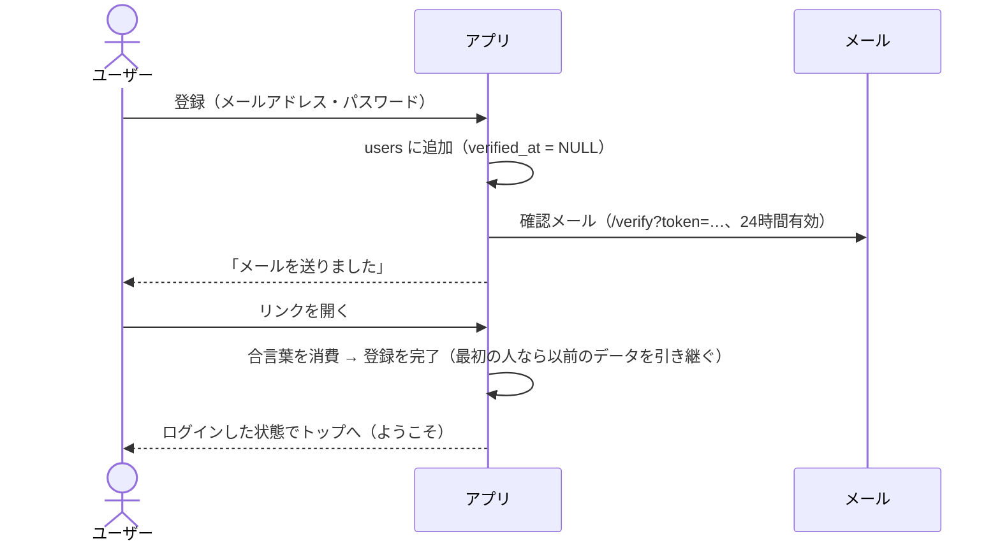

# ユーザー登録・ログイン

`lib/auth.js`、`lib/accounts.js`、`lib/password.js`、`app/auth/actions.js`、`app/verify/route.js`、`middleware.js`。

## 流れ

| 操作 | 処理 |
| --- | --- |
| 登録 `signup` | アドレスは前後の空白を除いて小文字に。パスワードは8〜200文字。登録済みなら「登録済みです」のメールだけ送る。未確認なら新しいパスワードにして確認メールを送り直す |
| 登録の完了 `/verify` | 合言葉が正しければ完了にしてログイン。だめなら再送の画面へ |
| 確認メールの再送 `resendVerify` | 未確認のユーザーにだけ送る |
| ログイン `login` | 正しければセッションを作り、`next` の画面へ（アプリの中のパスだけ。`//` で始まるものなどはトップへ） |
| ログアウト `logout` | セッションを消してログイン画面へ（ヘッダーの右上） |
| ヘッダーのアカウント | 表示名を出す（決めていなければ「アカウント」）。メールアドレスは出さない。押すとアカウントの画面へ |
| 再設定の申し込み `requestReset` | 登録済みのアドレスにリンク（1時間有効）を送る |
| 再設定 `resetPassword` | 新しいパスワードにし、ほかの端末のセッションをすべて消してログイン。未確認なら完了にする |
| パスワードの変更 `changePassword` | 今のパスワードを確かめて変更し、この端末以外のセッションを消す |

## 決まり（セキュリティ）

### パスワード
- scrypt（salt 16バイト、鍵長64バイト）でハッシュにして `scrypt$<salt>$<hash>` で保存する。比べるときは `timingSafeEqual`
- 登録のないアドレスでログインしようとしても、ダミーのハッシュで同じくらい時間をかける（`burnPasswordCheck`）

### 登録の有無を推測させない
- ログインの失敗は、アドレス違いもパスワード違いも同じメッセージ
- 登録・再送・再設定の申し込みは、アドレスが登録済みでもなくても「メールを送りました」と表示する。本当のことはメールの中でだけ伝える
- 同じ人に同じ種類のメールは60秒に1回まで（`RESEND_INTERVAL_SECONDS`）

### セッション・合言葉
- Cookie `flashcard_session` には32バイトのランダムな値を入れ、DB にはその sha256 だけを保存する（DB が漏れても Cookie を作れない）
- Cookie は httpOnly、SameSite=Lax、30日。`APP_URL` が https なら Secure
- メールの合言葉も同じく sha256 だけを保存。使ったら消す（1回だけ）。新しく送ると、同じ種類の古い合言葉は使えなくなる
- 期限切れのセッションは、新しいセッションを作るときに片付ける
- リダイレクト先は `APP_URL` から作る（コンテナの中のホスト名に飛ばないように）

## 使える人を決める（`lib/allowlist.js`）

環境変数 `ALLOWED_EMAILS` にメールアドレスをカンマ区切りで入れると、その人だけが使える。
インターネットに公開して、まず自分だけで使うときに設定する（[deploy.md](deploy.md)）。空なら、だれでも登録・ログインできる（手元の Docker では設定しない）。

- 大文字小文字と前後の空白は気にしない
- 登録: 決めた人でなければ「このアプリは、決まった人だけが使えます」と出し、ユーザーを作らず、メールも送らない
  （決めた人かどうかは、アドレスを打った人にわかってしまうが、だれが登録済みかはわからない）
- ログイン: 決めた人でなければ、登録済みでも「メールアドレスかパスワードが違います」
- 確認メールの再送・パスワードの再設定: 決めた人でなければ送らない（表示は同じ）
- ログインの状態（`getCurrentUser`）: 決めた人でなくなったユーザーは、セッションが残っていてもログインしていない扱い
- 画面（`isSignupOpen`）: だれでも登録できるように見せない。ホームページは「無料で始める」の代わりに「ログイン」と
  「今は、決まった人だけが使えます」を出す。ヘッダーとログインの画面には「新規登録」を出さない。
  新規登録の画面を直接開いたときは、決まった人だけが登録できると書く（決めた人は、ここから登録する）

## データの分離

- すべての画面と Server Action は、最初に `requireUser()` を呼ぶ（`middleware.js` は Cookie の有無しか見ないため）。
  例外はトップ（`/`）だけ: `getCurrentUser()` で、ログインしていなければホームページ（`app/landing/`）を、していればデッキの一覧を出す
- 読み書きは必ず自分のものに絞る:
  - デッキ: `WHERE user_id = $user`、または `ownsDeck(userId, deckId)`
  - カード: `ownsCard(userId, cardId)`、またはデッキと JOIN して `d.user_id = $user`
  - 学習の記録: デッキと JOIN（`recordReview` / `undoReview` は `FOR UPDATE OF c` / `OF l` でロック）
  - 設定・「知ってる」の語: `user_id`
- 他人のデッキ・カードの ID を指定されたら、「見つかりません」と同じ扱いにする（存在するかどうかも教えない）

## ユーザー管理より前のデータ

ユーザー管理を入れる前のデッキ・設定・「知ってる」の語は `user_id` が NULL のまま残っている。
**最初に登録を完了したユーザー**が、登録を完了したときにまとめて引き継ぐ（`activateUser`）。
2人が同時に完了しても1人だけが引き継ぐよう、`pg_advisory_xact_lock(7301)` で順番に処理する。

## メール（`lib/mail.js`）

- nodemailer。何も設定しなければ Mailpit（http://localhost:8025）に届き、外には送らない
- `.env` に SMTP の設定を書けば、本物のメールを送る（例は `.env.example`）
- 送れなかったら false を返し、画面に「メールを送れませんでした」と出す
