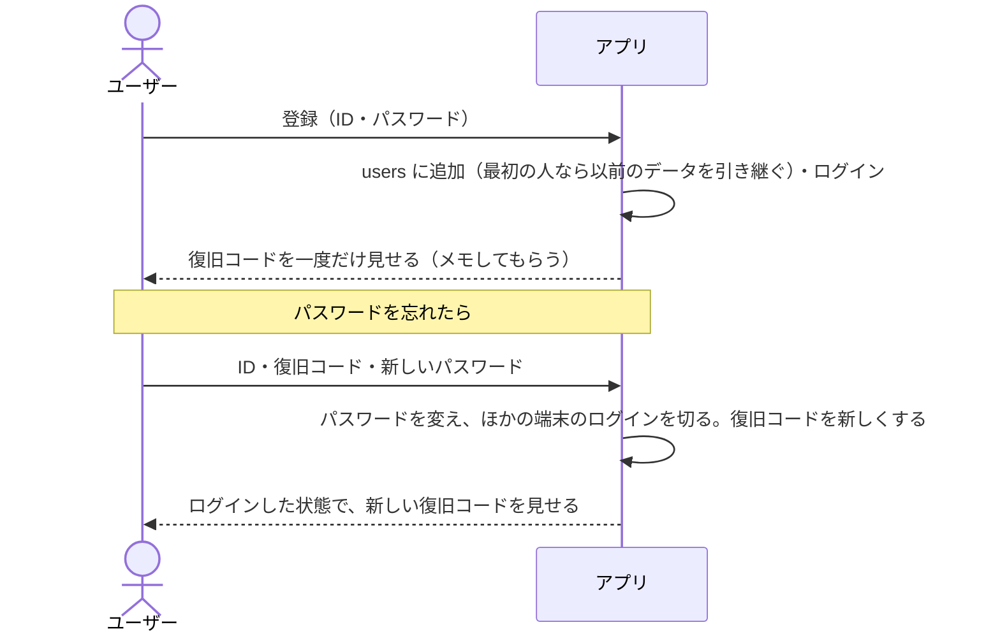
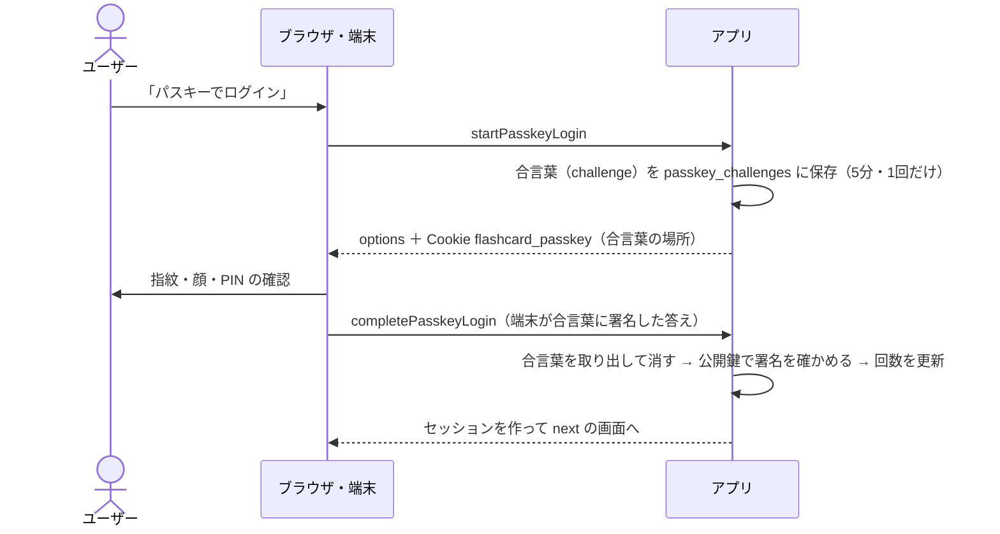

# ユーザー登録・ログイン

`lib/auth.js`、`lib/accounts.js`、`lib/username.js`、`lib/recovery.js`、`lib/password.js`、`app/auth/actions.js`、`middleware.js`。

メールアドレスは使わない（個人情報を持たないため）。ログインは **ID とパスワード**。
パスワードを忘れたときは、登録のときに渡す **復旧コード** で作り直す。だれでも登録できる。

## 流れ

| 操作 | 処理 |
| --- | --- |
| 登録 `signup` | ID とパスワードを決める。そのままログインし、復旧コードを返す（画面に一度だけ出す）。使われている ID なら「ほかの人が使っています」 |
| ログイン `login` | 正しければセッションを作り、`next` の画面へ（アプリの中のパスだけ。`//` で始まるものなどはトップへ） |
| ログアウト `logout` | セッションを消してログイン画面へ（ヘッダーの右上） |
| ヘッダーのアカウント | 表示名を出す（決めていなければ「アカウント」）。ログインの ID は出さない。押すとアカウントの画面へ |
| パスワードを忘れたとき `recoverPassword` | `/forgot-password`。ID と復旧コードが合えば新しいパスワードにし、ほかの端末のセッションをすべて消してログイン。使ったコードは使えなくなり、新しいコードを一度だけ出す |
| パスワードの変更 `changePassword` | 今のパスワードを確かめて変更し、この端末以外のセッションを消す |
| 復旧コードの作り直し `regenerateRecoveryCode` | アカウントの画面で。今のパスワードを確かめて新しいコードを出す（前のコードは使えなくなる）。コードを持っていない人（ID に切り替える前からのアカウント）には、作るように画面で知らせる |
| パスキーの登録 `startPasskeyRegistration` → `completePasskeyRegistration` | アカウントの画面で。ログイン中の人が、この端末にパスキーを作る（名前は任意、30文字まで） |
| パスキーでログイン `startPasskeyLogin` → `completePasskeyLogin` | ログインの画面の「パスキーでログイン」。ID は入れず、端末がパスキーを選ぶ。正しければセッションを作り、`next` の画面へ |
| パスキーの削除 `removePasskey` | アカウントの画面で。自分のパスキーだけ |

## 決まり（セキュリティ）

### ID（`lib/username.js`）
- 英小文字・数字・「_」「-」で3〜20文字。最初は英小文字か数字。大文字で入れても小文字にする（`Taro` と `taro` は同じ）
- 「guest」で始まる ID は使えない（おためしユーザー `guest-<ランダム>` のため）
- ID はログインにだけ使い、ほかの人には見せない（みんなの単語帳などには表示名を出す）

### パスワード
- 8〜200文字。scrypt（salt 16バイト、鍵長64バイト）でハッシュにして `scrypt$<salt>$<hash>` で保存する。比べるときは `timingSafeEqual`
- 登録のない ID でログインしようとしても、ダミーのハッシュで同じくらい時間をかける（`burnPasswordCheck`）
- ログインの失敗は、ID 違いもパスワード違いも同じ「ID かパスワードが違います」

### 復旧コード（`lib/recovery.js`）
- 4文字×4つ（例 `K7QM-3XWP-9TZD-H2RB`）。読み間違えやすい文字（0・O・1・I・L・U）は使わない。約78ビットのランダムな値
- DB には sha256 だけを保存する（`users.recovery_code_hash`）。コードそのものは、作ったときに一度だけ画面に出す
- 入れるときは、小文字・空白・「-」のちがいを気にしない。比べるときは `timingSafeEqual`
- 1回使ったら新しいコードに変わる。同じコードで同時に2回送られても、通るのは1回だけ（コードが変わっていないときだけ更新する）
- 失敗は、ID 違い・コード違い・コードを持っていない人も同じ「ID か復旧コードが違います」。おためしユーザーには使えない
- メールアドレスがないので、**パスワードも復旧コードもなくすと、アカウントに戻れない**（画面でそう伝える。管理者は `scripts/create-user.mjs` でパスワードを作り直せる）

### 登録の回数（いたずら対策）
- 同じ接続元（IP アドレス。`x-forwarded-for` の最初の値）から登録できるのは、1日（24時間）に5回まで（`MAX_SIGNUPS_PER_IP`）。
  IP アドレスはハッシュにして `signup_starts` に保存し、1日たったら消す
- 数えるときは `pg_advisory_xact_lock(hashtext('flashcard-signup'))` で順番に処理する（同時に送られても数をこえない）
- 手元の開発サーバー（`next dev`）では、動作を何度も確かめられるよう、回数の制限をかけない

### セッション
- Cookie `flashcard_session` には32バイトのランダムな値を入れ、DB にはその sha256 だけを保存する（DB が漏れても Cookie を作れない）
- Cookie は httpOnly、SameSite=Lax、30日。`APP_URL` が https なら Secure
- 期限切れのセッションは、新しいセッションを作るときに片付ける
- リダイレクト先は `APP_URL` から作る（コンテナの中のホスト名に飛ばないように）

## 管理者（`lib/admin.js`）

環境変数 `ADMIN_USERNAMES` にログインの ID をカンマ区切りで入れると、その人が管理者になり、管理者の画面（`/admin`、[features.md](features.md#15-管理者の画面appadminlibadminstatsjs)）を開ける。
空なら、だれも管理者でない。

- 大文字小文字と前後の空白は気にしない。おためしユーザーは管理者にしない
- 管理者でない人が `/admin` を開くと「見つかりません」（画面があることを知らせない）。ログインしていなければログイン画面へ

## 管理用の道具（`lib/userAdmin.js`、`scripts/`）

公開した DB を手元から直すための道具（手順は [deploy.md](deploy.md)）。接続の文字列とパスワードは画面に出さない。手元の `DATABASE_URL` は使わず、毎回つなぐ先を聞く。

| 道具 | すること |
| --- | --- |
| `scripts/create-user.mjs` | アカウントを作る（ID とパスワードの決まりは登録の画面と同じ。復旧コードを画面に出す）。使われている ID なら、パスワードを作り直すか聞く（作り直すと、その人のセッションをすべて消す） |
| `scripts/rename-user.mjs` | ID を変える。先にアカウントの一覧（ID・登録日・単語帳とカードの数）を出す。データ・パスワード・ログインはそのまま。使われている ID・おためしユーザーには変えない |
| `scripts/reset-user.mjs` | データを最初の状態に戻す。その人の単語帳（カード・記録などもいっしょに）・レベル設定・「知ってる」の語・勉強時間を消し、「はじめの4ステップ」を閉じた印も消す。アカウント・パスワード・ログインは残す。1つの SQL で行う（途中で失敗したら何も消えない）。消す前に、同じ ID をもう一度入れてもらう |

## パスキー（`lib/passkeys.js`、`app/auth/passkeyActions.js`、`app/auth/PasskeyButtons.js`）

パスワードの代わりに、端末の指紋・顔・PIN でログインする（WebAuthn。ライブラリは `@simplewebauthn/server` と `@simplewebauthn/browser`）。
パスワードのログインも、今までどおり使える。

- 鍵は端末の中で作られ、**公開鍵だけ** を `passkeys` に保存する。DB が漏れても、そこからログインはできない
- パスキーはこのアプリのドメイン（`APP_URL` のホスト名。手元では `localhost`。Vercel で `APP_URL` がなければ本番の URL。`lib/appUrl.js`）に結びつく。ほかのサイトでは使えず、ほかのサイトの答えも受け付けない。
  **公開する URL（ドメイン）を変えると、それまでのパスキーは使えなくなる**（もう一度登録してもらう）
- 合言葉は DB に保存し、Cookie にはその場所を示すランダムな値だけを入れる（DB には sha256。httpOnly、SameSite=Strict、5分）。
  取り出したら、成功しても失敗しても消す（同じ答えの使い回しを防ぐ）。登録用とログイン用は分け、登録用は始めた人にしか使えない
- 端末が数える使用回数が前より戻ったら、鍵の複製を疑ってログインさせない（0 のままの端末は数えない）
- おためしの期限が過ぎた人は、パスキーがあってもログインできない
- ログインの失敗は、どの理由でも「パスキーでログインできませんでした」（登録の有無を推測させない）
- アプリのドメインと、開いているページのドメインが違うと、ブラウザはパスキーを使わせない。そのときは画面に、両方のドメインと「APP_URL を直してください」を出す
- 端末に渡す利用者の ID は、ユーザーの番号から作ったハッシュ（番号そのものは見せない。同じ人なら同じ値なので、同じ端末に登録し直すと上書きになる）
- 端末は、本人確認（指紋・顔・PIN）を「できればする」（`userVerification: preferred`）。
  登録は「端末に保存するパスキー」だけ（`residentKey: required`。ID を入れずにログインできる）
- ユーザーを消すとパスキーも消える。パスワードを変えても、パスキーは残る

## おためしユーザー（`lib/guest.js`、`app/try/`）

新規登録をせずに、1日だけ全機能を試せるアカウント。ホームページ・ヘッダー・ログインの画面の「登録せずに試す」から `/try` を開き、
「1日たつと、すべて削除される」ことにチェックを入れて「おためしを始める」を押すと、その人だけのアカウントを作ってログインする。

- ユーザー: `users.guest_expires_at`（期限）が入っている。ID は `guest-<ランダム>`（ふつうの人は「guest」で始まる ID を使えない）、
  パスワードはどれとも合わない値（パスワードではログインできない）。セッションの期限も、アカウントの期限と同じにする
- 期限は始めてから24時間（`GUEST_HOURS`）。期限が過ぎたら、まだ削除されていなくてもログインしていない扱い（`getCurrentUser`）
- 削除: アカウントごと消す（単語帳・カード・学習の記録・設定・セッションも `ON DELETE CASCADE` で消える）。消すのは次のとき
  - 1日1回の片付け（`/api/cron/cleanup-guests`。Vercel の Cron が呼ぶ。`vercel.json`）。期限の過ぎた人を消すだけなので、合言葉はいらない
  - だれかがログインした・おためしを始めたとき（ついでに片付ける）
  - 本人が「おためしを終える」を押したとき（アカウントの画面。その場で消して、ログアウトする）
- いたずらで大量に作られないように（数は `lib/guest.js` の定数。変えるときはテストと画面の説明も直す）
  - 同じ接続元（IP アドレス。`x-forwarded-for` の最初の値）から始められるのは、1日に3回まで。おためしを終えても回数は戻らない（`guest_starts`）。IP アドレスはハッシュにして保存し、1日たったら消す。管理者の画面のため、日ごとの回数だけは `guest_daily` に残す
  - 同時に使えるおためしユーザーは30人まで。全体で1日に始められるのは100回まで
  - 手元の開発サーバー（`next dev`。Docker の localhost:3000）では、動作を何度も確かめられるよう、
    始められる回数の制限（同じ接続元の1日3回・全体の1日100回）をかけない。同時に30人までの制限と、作れる量の制限はかける
  - 作れる量: 単語帳は5冊まで、カードは全部で200枚まで、物語の絵は全部で10MB まで（ふつうのユーザーには制限はない）
- 使えない機能（「おためし中は使えません」）: 単語帳の公開、表示名、パスワードの変更、パスキーの登録。
  ほかの人に見えるもの・アカウントを残すためのものは、おためしでは使わせない
- 画面: ヘッダーに「おためし中（あと N 時間）」（ログアウトの代わり）。アカウントの画面は、削除される日時と「おためしを終える」だけ
- 最初から入っている単語帳（`lib/starterDeck.js`）: 始めるとすぐ、2冊が入る。この2冊も、単語帳5冊・カード200枚の中に数える
  - 動画の単語帳「Grand Train Tour of Switzerland…」: 字幕・AI で整えた文（和訳つき）・カード5枚が入っている。
    字幕から例文を追加・動画の再生・記憶テストを、字幕を貼らずにすぐ試せる。
    中身は `data/starter/grand-train-tour.json`（手元の DB の単語帳を `scripts/export-deck.mjs` で書き出したもの。差し替えるときも同じ道具を使う）
  - 物語の単語帳「物語: The First Pancake」: このアプリのために書いた短い物語（8文・カード6枚、和訳と語句の意味つき）。物語のスライド・読み上げを試せる
- 新しい単語帳の画面: どの動画にするか迷わないよう、サンプルの動画（`lib/sampleVideos.js`。2〜4分・字幕は英語だけ・埋め込める動画。日本語の字幕もある動画は、日本語の画面では文字起こしが日本語で出てしまうので選ばない）を出す。
  「YouTube で開く」は別のタブで動画を開く（字幕をコピーするため）。「この動画を使う」を押すと、URL の欄に入る。動画が消えたり埋め込めなくなったりしたら、差し替える
- ログインし直す方法はない（パスワード・復旧コードがない）。同じブラウザなら、閉じても期限までは続きから使える

## データの分離

- すべての画面と Server Action は、最初に `requireUser()` を呼ぶ（`middleware.js` は Cookie の有無しか見ないため）。
  例外はトップ（`/`）だけ: `getCurrentUser()` で、ログインしていなければホームページ（`app/landing/`）を、していれば単語帳の一覧を出す
- 読み書きは必ず自分のものに絞る:
  - 単語帳: `WHERE user_id = $user`、または `ownsDeck(userId, deckId)`
  - カード: `ownsCard(userId, cardId)`、または単語帳と JOIN して `d.user_id = $user`
  - 学習の記録: 単語帳と JOIN（`recordReview` / `undoReview` は `FOR UPDATE OF c` / `OF l` でロック）
  - 設定・「知ってる」の語: `user_id`
  - パスキー: `user_id`（一覧・削除。ログインのときは、端末が示したパスキーの持ち主になる）
- 他人の単語帳・カードの ID を指定されたら、「見つかりません」と同じ扱いにする（存在するかどうかも教えない）

## ユーザー管理より前のデータ

ユーザー管理を入れる前の単語帳・設定・「知ってる」の語は `user_id` が NULL のまま残っている。
**最初に登録したユーザー**（おためしユーザーは数えない）が、登録したときにまとめて引き継ぐ（`claimLegacyData`）。
2人が同時に登録しても1人だけが引き継ぐよう、登録の回数を数えるときと同じロックで順番に処理する。

## メールアドレスから ID への切り替え（migration 025）

前は、メールアドレスとパスワードでログインし、確認メール・再設定のメールを送っていた。新しく登録する人の個人情報を持たないため、ID に切り替えた。

- 今までのアカウントは、**メールアドレス（小文字）がそのまま ID** になる（おためしユーザーは `guest-<番号>`）。
  今までどおり、メールアドレスとパスワードでログインできる。パスワード・データ・パスキーもそのまま。
  新しく登録する人の ID には「@」を使えないので、ぶつからない。好きな ID に変えるときは `scripts/rename-user.mjs`
- そのため、前からのアカウントのメールアドレスは、ID として DB に残る（新しく登録する人のものは持たない）
- ログインの画面に「前からお使いの方は、そのメールアドレスが ID です」と出す。ログイン・パスワードを忘れたときの ID の欄は、
  メールアドレスが入るよう254文字まで入れられる（新規登録の欄は20文字まで）
- 登録を完了していなかった（確認メールのリンクを開いていない）アカウントは消す
- `users.email`・`users.verified_at`・`email_tokens` テーブルを消す。メールを送る仕組み（SMTP・Mailpit）もなくした
- 今までのアカウントには復旧コードがない。アカウントの画面で作るよう知らせる（作るまでは、パスワードを忘れたときの画面は使えない。管理者が `scripts/create-user.mjs` でパスワードを作り直す）
