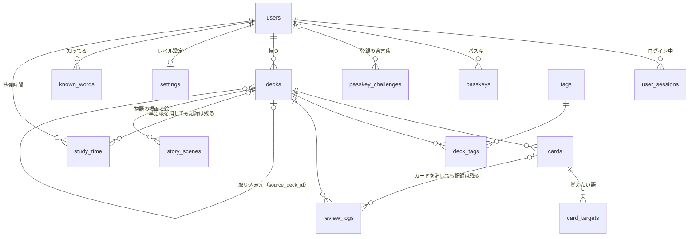

# データモデル

PostgreSQL 17。テーブル同士の関係とマイグレーションの履歴を書く。列の定義は [tables.md](tables.md)。
テーブルの変更はすべて `db/migrations/` の SQL で行う（[architecture.md](architecture.md)）。

## 関係

- ユーザーを消すと、そのユーザーの単語帳・カード・設定などはすべて消える（`ON DELETE CASCADE`）。
  おためしユーザー（`users.guest_expires_at` がある）は、期限が過ぎるとこの形で丸ごと消す
- `guest_starts`（おためしを始めた記録）と `guest_daily`（日ごとの回数）は、どのテーブルともつながっていない（ユーザーを消しても残る）
- 単語帳を消すと、カード・覚えたい語・タグの付け外し・学習の記録が消える
- 公開した単語帳を取り込むと、単語帳とカードがコピーされる（[features.md](features.md#10-単語帳の共有libsharingjsappshared)）。
  コピーの `source_deck_id` は取り込み元を指し、元を消すと NULL になる（コピーは消えない）
- カードを消しても学習の記録（`review_logs`）は残り、`card_id` が NULL になる（統計の日ごとの回数を変えないため）
- 単語帳を消しても勉強時間（`study_time`）は残り、`deck_id` が NULL になる（勉強した時間は変えないため）
- `decks.user_id` / `settings.user_id` / `known_words.user_id` が NULL の行は、ユーザー管理を入れる前のデータ。
  最初に登録を完了したユーザーが引き継ぐ（[auth.md](auth.md)）

## テーブル

各テーブルの全列（型・NULL の可否・初期値・説明）、主キー・外部キー・インデックスは
[テーブル定義書（tables.md）](tables.md) を見てください。

## マイグレーション

| ファイル | 内容 |
| --- | --- |
| 001_initial.sql | 最初のテーブル（decks、cards） |
| 002_sentence_mining.sql | 字幕から例文カードを作る（覚えたい語、動画の時刻、known_words、settings） |
| 003_deck_source.sql | 単語帳に動画と字幕を保存 |
| 004_card_ai_details.sql | AI の解説（和訳・意味・例文・豆知識） |
| 005_deck_sentences.sql | AI で整えた文を単語帳に保存 |
| 006_card_review.sql | 記憶テストの列 |
| 007_card_translation_form.sql | 和訳の中の対応部分 |
| 008_review_logs.sql | 学習の記録 |
| 009_review_log_undo.sql | 記録に答える前の値を持たせる（取り消し用） |
| 010_deck_tags.sql | タグ |
| 011_card_targets.sql | 1枚のカードに覚えたい語を複数 |
| 012_story_decks.sql | 物語の単語帳 |
| 013_users.sql | ユーザー管理（users、セッション、メールのリンク、各テーブルに user_id） |
| 014_sharing.sql | 単語帳の共有（users.display_name、decks.published_at・source_deck_id） |
| 015_videos.sql | おすすめの動画のための、YouTube の動画の情報（videos） |
| 016_videos_oembed.sql | 動画の情報を API キーなし（oEmbed）で取る形に（公開の状態・長さ・埋め込みの列を消し、available を足す） |
| 017_study_time.sql | 勉強時間（study_time） |
| 018_story_scenes.sql | 物語の場面と、場面の絵（story_scenes） |
| 019_onboarding.sql | 「はじめの4ステップ」を閉じた日時（users.onboarding_dismissed_at） |
| 020_drop_videos.sql | 「動画を探す」（おすすめの動画）をなくしたので、videos を消す |
| 021_passkeys.sql | パスキー（passkeys）と、登録・ログインの合言葉（passkey_challenges） |
| 022_guests.sql | おためしユーザー（users.guest_expires_at）と、おためしを始めた記録（guest_starts） |
| 023_sample_decks.sql | おためしユーザーに最初から入れた単語帳の印（decks.is_sample） |
| 024_guest_daily.sql | おためしを始めた回数を日ごとに数える（guest_daily）。管理者の画面のため |
| 025_usernames.sql | メールアドレスをやめて ID でログインする（users.username・recovery_code_hash を足し、email・verified_at・email_tokens を消す。今までのアカウントはメールアドレスをそのまま ID にする。確認していないアカウントを消す）。登録の回数を数える signup_starts |
| 026_terms.sql | 利用規約に同意した記録（users.terms_version・terms_agreed_at）。前からのアカウントは NULL（次に使うとき同意してもらう） |

決まり:
- 当てたファイルは書き換えない。直すときは次の番号のファイルを足す
- 単体テストは毎回、空の DB に 001 から全部を当てる（空の DB に当たらないマイグレーションはテストで分かる）
